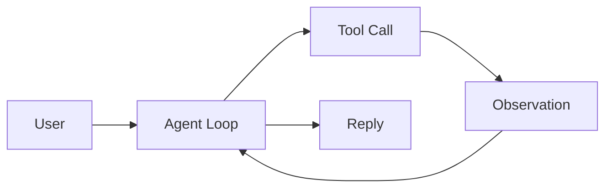

# Design-to-Code Agent

一个基于 ReAct 循环的交互式终端 Coding Agent：读取结构化设计，调用工具读写代码、运行测试，并在多轮对话中持续修改和验证 `workspace/` 中的实现。

项目只依赖 Python 标准库和 `openai` SDK，不使用 LangChain、LangGraph、CrewAI 等 Agent 框架，目的是显式展示 LLM 决策、工具分发和上下文回灌三个底层机制。



## 当前功能

- **交互式 CLI**：`python agent.py` 启动多轮终端会话
- **会话内记忆**：保留系统消息、历史需求、工具调用和工具结果
- **设计读取**：从 `design_samples/` 读取 JSON 设计
- **代码生成与修改**：在 `workspace/` 创建或覆盖文件
- **测试执行**：运行整个 `workspace/` 的 pytest
- **失败回灌**：测试失败后读取错误并继续修复
- **ReAct 循环**：每个用户请求最多执行 10 步
- **路径沙箱**：设计和写入范围受到路径检查
- **`.env` 支持**：从项目根目录 `.env` 读取 `DEEPSEEK_API_KEY`
- **Mock 模式**：无 API Key 也能查看预置轨迹
- **多轮迭代**：可以基于上一轮生成的代码继续修改

> 当前系统提示词是通用交互式提示词，不再强制每次生成工业状态机、追溯注释或测试。Agent 仍然可以完成这些事情，但需要用户在需求中明确提出。

## 当前示例

### 工业状态机：MotorController

`design_samples/design.json` 定义了 `REQ-MOTOR-001`：

- 状态：`IDLE`、`RUNNING`、`FAULT`
- 转换：`start`、`stop`、`update_temperature`、`reset`
- 安全约束：过温锁存、FAULT 禁止启动、安全 reset 等
- 验收标准：`AC-001` 到 `AC-008`

参考生成结果：

- [motor_controller.py](<C:/Users/VV/Desktop/code agent/design-to-code-agent/workspace/motor_controller.py>)
- [test_motor_controller.py](<C:/Users/VV/Desktop/code agent/design-to-code-agent/workspace/test_motor_controller.py>)

### 交互式生成演示：bubble_sort

`workspace/` 中还保留了一份通过多轮对话生成的冒泡排序演示：

- `bubble_sort.py`
- `test_bubble_sort.py`

它用于展示“先实现，再根据追加要求修改测试”的交互能力，不属于 `design.json` 的工业状态机需求。

当前工作区最近一次测试结果：

```text
48 passed
```

其中 MotorController 31 个测试，bubble_sort 17 个测试。实际数量会随 `workspace/` 内容变化。

## 项目结构

```text
design-to-code-agent/
├── agent.py                    # 交互式 CLI + ReAct 循环 + Mock 入口
├── tools.py                    # 4 个工具的实现与 JSON Schema
├── llm_client.py               # DeepSeek OpenAI 兼容客户端
├── design_samples/
│   └── design.json             # MotorController 设计
├── workspace/
│   ├── motor_controller.py     # 参考生成结果
│   ├── test_motor_controller.py
│   ├── bubble_sort.py          # 多轮交互演示
│   └── test_bubble_sort.py
├── .env.example                # API Key 模板
├── .gitattributes
├── .gitignore
├── requirements.txt
└── README.md
```

`workspace/` 同时是 Agent 的唯一写入沙箱。仓库中保留了当前验证过的示例输出；重新运行 Agent 时，它可以通过 `write_file` 覆盖这些文件。

## 快速运行

要求 Python 3.10+。

```powershell
cd "C:\Users\VV\Desktop\code agent\design-to-code-agent"

python -m venv .venv
.\.venv\Scripts\python.exe -m pip install -r requirements.txt
```

### 配置 API Key

复制模板：

```powershell
Copy-Item .env.example .env
notepad .env
```

填写：

```text
DEEPSEEK_API_KEY=sk-你的真实Key
```

也可以在 PowerShell 中直接设置：

```powershell
$env:DEEPSEEK_API_KEY = "sk-你的真实Key"
```

`agent.py` 启动时会读取项目根目录的 `.env`，但不会覆盖已经存在的系统环境变量。

`.env` 已被 `.gitignore` 忽略，不要提交真实 Key。仓库只提交 `.env.example`。

### 启动交互模式

```powershell
.\.venv\Scripts\python.exe agent.py
```

启动后示例：

```text
交互式 Coding Agent 已启动。输入 exit 或 quit 退出。

你> 读取 design_samples/design.json，检查 motor_controller.py 是否满足设计
...
你> 把温度阈值改成 90，并同步修改相关测试
...
你> 再补充 reset 的边界测试并运行
...
你> exit
```

特点：

- `messages` 在整个进程内保留
- 第二轮可以直接引用第一轮的结果
- 每轮会打印“第几轮对话”
- `exit` / `quit` 退出
- `Ctrl+C` / `Ctrl+D` 也会安全退出

### Mock 模式

```powershell
.\.venv\Scripts\python.exe agent.py --mock
```

Mock 模式不会调用 API，也不会修改 `workspace/`，只打印预置轨迹。

### 运行测试

```powershell
.\.venv\Scripts\python.exe -m pytest -q workspace
```

## Agent 循环

每个用户请求都会进入一次 `agent_loop`：

1. 用户输入被追加为 `{"role": "user", "content": ...}`
2. 模型读取 system prompt 和完整历史
3. 模型自主决定是否返回 `tool_calls`
4. 主循环用 `json.loads` 解析参数
5. 工具结果以 `{"role": "tool", "tool_call_id": ...}` 回灌
6. 模型继续决策，最多 10 步
7. 没有工具调用时，最终回答被追加为 assistant 消息

伪代码：

```python
while True:
    user_input = input("你> ")
    if user_input in {"exit", "quit"}:
        break
    messages.append({"role": "user", "content": user_input})
    agent_loop(client, messages, turn)
```

测试失败路径：

```text
run_tests
→ TESTS_FAILED + stdout/stderr
→ read_error
→ 模型分析业务代码或测试预期
→ write_file 修复
→ run_tests
→ TESTS_PASSED
→ 简短汇报
```

## 运行 Trace 示例

`--mock` 模式会打印一条预置轨迹，用来展示 `Thought → Action → Observation → Finish` 的结构。它不会调用真实 API，也不会修改文件。

```text
[Step 1] Thought: 读取工业设计，提取状态机、约束和追溯 ID。
Action: read_design({"path": "design_samples/design.json"})
Observation: {"requirement_id": "REQ-MOTOR-001", "class": "MotorController", ...}

[Step 2] Thought: 用 Class 实现状态机，并将约束绑定到追溯注释。
Action: write_file({"path": "motor_controller.py", ...})
Observation: OK: wrote motor_controller.py

[Step 3] Thought: 生成覆盖状态、转换和约束的测试。
Action: write_file({"path": "test_motor_controller.py", ...})
Observation: OK: wrote test_motor_controller.py

[Step 4] Thought: 运行完整测试套件并确认安全约束。
Action: run_tests({})
Observation: TESTS_PASSED (exit 0)
31 passed in 0.04s

Finish: 已生成 MotorController 和测试，31 个测试通过。
```

真实交互模式采用同样的工具调用结构，但每个用户需求都会产生新的一轮 `agent_loop`，并复用之前的 `messages`。

## 系统提示词

当前 `SYSTEM_PROMPT`：

```text
你是一个交互式编程 Agent。你可以使用工具读取设计、写代码、跑测试。
当用户提出需求或修改意见时，请自主决定是否需要调用工具。
如果测试失败，请分析错误并修复。
如果任务完成，请简短汇报。
不要重复相同的失败调用。
```

这意味着：

- Agent **可以**生成类、状态机、测试和追溯注释
- 但不会仅因为读取了 `design.json` 就自动执行这些行为
- 用户需要明确说“生成测试”“加追溯注释”“按状态机实现”
- 测试修改也没有机械化审计，模型仍可能改测试让测试通过

## 工具契约

只保留 4 个工具，参数使用完整 JSON Schema。

| 工具 | 输入 | 作用 |
|---|---|---|
| `read_design` | `path` | 读取 `design_samples/` 下的设计文件 |
| `write_file` | `path`, `content` | 在 `workspace/` 下创建或覆盖文件 |
| `run_tests` | 无 | 在 `workspace/` 执行 `python -m pytest -q`，30 秒超时 |
| `read_error` | 无 | 返回最近一次失败测试输出 |

### 沙箱边界

- `read_design` 在 `resolve()` 后检查路径是否位于 `design_samples/`
- `write_file` 在 `resolve()` 后检查目标是否以 `workspace/` 绝对路径为前缀
- 拒绝 `..` 穿越、目录本身和未知工具
- 工具异常统一转成错误字符串
- `run_tests` 超时或 pytest 不存在时也会返回错误信息

这是路径级沙箱，不是操作系统级安全隔离。`run_tests` 会执行工作区中的 Python 代码，生产环境应增加容器或进程隔离。

## 追溯示例

当前参考实现保留了设计元素到代码的追溯注释：

```python
class MotorController:
    # [Trace: REQ-MOTOR-001/ST-001] initial state is IDLE
    self._state = self.IDLE

    def start(self) -> None:
        if self._state == self.FAULT:
            # [Trace: REQ-MOTOR-001/CN-001]
            raise SafetyInterlockError(...)
        # [Trace: REQ-MOTOR-001/TR-001]
        self._state = self.RUNNING
```

测试文件也包含对应的验收标准 ID：

```python
def test_start_in_fault_raises_safety_interlock_and_stays_fault():
    # [Trace: REQ-MOTOR-001/AC-005] [Trace: REQ-MOTOR-001/CN-001]
    m = MotorController(81)
    with pytest.raises(SafetyInterlockError):
        m.start()
    assert m.state == "FAULT"
```

这些追溯注释是当前示例的能力展示，不是新版系统提示词的强制要求。

## 为什么不用 Agent 框架

本项目刻意保留三个显式机制：

1. **ReAct 循环**：`agent_loop` 中的 `for step in range(MAX_STEPS)` 直接完成“请求模型 → 工具 → 观察 → 再请求”。
2. **工具分发**：`tools.py` 用字典分发 4 个工具，JSON Schema 显式定义参数。
3. **上下文管理**：assistant 的 `tool_calls`、每个工具结果和最终回答都由主循环手动拼接。

没有框架状态对象、隐藏的 executor 或自动记忆层。

## 设计取舍

### 做了

- 把单次运行改造成多轮交互式 CLI
- 保留完整 `messages` 历史，支持“继续修改刚才的代码”
- 保持原有 ReAct 循环和 4 个工具
- 增加 `.env` 读取，同时兼容系统环境变量
- 保留失败回灌和测试修复能力
- 保留 Mock 模式
- 保持最小依赖和路径沙箱

### 没做

- 没有跨进程持久记忆，关闭程序后历史丢失
- 没有长期记忆、向量检索、多 Agent 协作
- 没有 `list_files`、`delete_file`、`rename_file` 或 `apply_patch`
- 不能只运行指定测试文件，`run_tests` 始终运行整个 `workspace/`
- 没有静态检查、类型检查、覆盖率或依赖安装
- 没有 JSON Schema 校验设计文件
- 没有 token 预算和上下文裁剪，长对话可能超出上下文
- 没有操作系统级代码执行隔离
- 没有机械化的测试质量审计
- 没有强制生成工业状态机、追溯注释或测试

## 开发与验证

```powershell
# 语法检查
.\.venv\Scripts\python.exe -m py_compile agent.py tools.py llm_client.py

# Mock 轨迹
.\.venv\Scripts\python.exe agent.py --mock

# 完整测试
.\.venv\Scripts\python.exe -m pytest -q workspace
```

## 与后续毕设的衔接

- `read_design` 是“设计理解”的入口，后续可扩展为 UML、接口契约或自然语言设计文档解析。
- `run_tests` + `read_error` + tool 消息回灌是“质量验证”的反馈钩子，后续可接入静态检查、覆盖率或自定义验收器。
- `messages` 中的 Action / Observation 是可追溯记录，后续可构建“设计元素 → 生成代码 → 测试结果”的追溯图。
- 当前的 `requirement_id`、`TR-*`、`CN-*`、`AC-*` 可作为追溯图节点；多轮交互则提供了迭代决策的时间序列。
