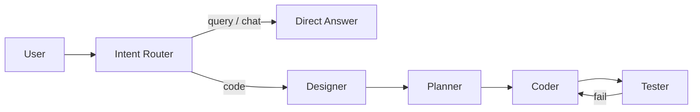

# Design-to-Code Agent

一个支持**单 Agent 交互**与**多 Agent 协同**的终端 Coding Agent：先进行意图路由，再根据用户需求动态生成设计摘要、代码与 pytest 测试；代码任务失败时把错误反馈给代码生成 Agent 继续修复。

项目只依赖 Python 标准库和 `openai` SDK，不使用 LangChain、LangGraph、CrewAI 等 Agent 框架。ReAct 循环、工具分发、共享状态和角色协作全部显式实现，便于观察和调试。



## 当前能力

- **单 Agent 交互模式**：多轮对话、会话内记忆、工具调用
- **多 Agent 交互模式**：三分类意图路由 → Designer → Planner → Coder → Tester
- **三分类意图路由**：`CODE`、`QUERY`、`CHAT`
- **QUERY / CHAT 直答**：询问状态、代码位置、失败原因、日常问候时不进入代码流水线
- **QUERY 兜底守卫**：即使路由器误判，“代码在哪里”“刚刚做了什么”也会被强制纠正为 QUERY
- **最近状态注入**：直答会携带最近一次代码任务的成功/失败状态和写入文件路径
- **动态设计**：Designer 根据当前需求生成设计摘要；只有明确要求时才读取 `design.json`
- **共享状态**：`user_requirement`、`design_content`、`plan`、`code_content`、`test_result`、`iterations`、`files_written`
- **状态隔离**：每轮新代码任务都创建全新的 State，避免上一轮错误污染
- **失败修复闭环**：测试失败后 `iterations += 1`，错误回传给 CoderAgent
- **最大修复次数**：超过 3 次强制退出当前流水线
- **追溯注释**：设计摘要包含 Trace ID 时，Coder 保留 `[Trace: REQ-.../ID]`
- **清晰日志**：Agent 分色分隔、工具参数截断、长输出首尾截断
- **路径沙箱**：读取限制在 `design_samples/`，写入限制在 `workspace/`
- **`.env` 支持**：从项目根目录读取 `DEEPSEEK_API_KEY`
- **Mock 模式**：无 API Key 也能查看固定轨迹

## 架构

### 多 Agent 流水线

```text
用户输入
  ↓
Intent Router    判断 CODE / QUERY / CHAT；CODE 时提取 user_requirement
  ├─ QUERY / CHAT → DirectAnswer 直接回答（携带最近 State，不重跑流水线）
  └─ CODE ↓
DesignerAgent    按需读取 design.json，或根据本轮需求动态生成设计摘要
  ↓
PlannerAgent     只基于本轮需求和设计摘要生成开发步骤 JSON
  ↓
CoderAgent       通过 write_file 写入业务代码与测试
  ↓
TesterAgent      运行 pytest；失败时分析并写入 test_result
  ↓
Orchestrator     测试失败则回到 CoderAgent，最多修复 3 次
```

### 意图路由与动态设计

路由由大模型完成，输出严格 JSON：

```json
{"intent": "code", "user_requirement": "写一个冒泡排序", "reason": "用户要求编写代码"}
```

```json
{"intent": "query", "user_requirement": "", "reason": "询问代码位置"}
```

```json
{"intent": "chat", "user_requirement": "", "reason": "日常问候"}
```

- **CODE**：创建全新的 State，把 `user_requirement` 传给四个角色
- **QUERY / CHAT**：直接调用 DirectAnswer，不创建 State，不运行流水线
- **QUERY 兜底**：明确的“代码在哪/刚刚做了什么”问题即使被模型误判成 CODE，也会被本地规则纠正
- **QUERY 上下文**：最近一次 State 的测试状态、修复次数和 `files_written` 路径会注入回答
- **动态设计**：用户说“写一个冒泡排序”时，Designer 不读 `design.json`；只有用户明确说“按设计文件实现”时才调用 `read_design`
- **会话上下文**：最近 12 条对话保存在内存中，供路由和直答使用

### 共享状态

`run_multi_pipeline()` 每轮创建新的状态字典：

```python
state = {
    "user_requirement": user_requirement,
    "design_content": "",
    "plan": [],
    "code_content": "",
    "test_result": "",
    "iterations": 0,
    "files_written": [],
}
```

状态会在四个 Agent 之间传递并原地更新，作为“追溯图”的原型数据。

### 四个角色

| Agent | 职责 | 使用工具 |
|---|---|---|
| `DesignerAgent` | 按需读取设计，或根据本轮用户需求动态生成设计摘要 | `read_design`（仅明确要求时） |
| `PlannerAgent` | 只基于本轮需求和设计摘要生成开发步骤 JSON | 无 |
| `CoderAgent` | 生成或修复业务代码和测试；`write_file` path 使用 `tests/` 相对路径 | `write_file` |
| `TesterAgent` | 运行 pytest，分析失败，不修改代码 | `run_tests`, `read_error` |

每个 Agent 使用不同的 System Prompt，职责边界明确：

- Designer：只做设计理解，不写代码
- Planner：只做任务规划，输出严格 JSON
- Coder：执行者，必须真正调用 `write_file`
- Tester：严苛测试员，只分析，不改代码

## 运行方式

要求 Python 3.10+。

```powershell
cd design-to-code-agent

python -m venv .venv
.\.venv\Scripts\python.exe -m pip install -r requirements.txt
```

### 配置 API Key

```powershell
Copy-Item .env.example .env
notepad .env
```

填写：

```text
DEEPSEEK_API_KEY=sk-你的真实Key
```

也可以直接设置当前终端环境变量：

```powershell
$env:DEEPSEEK_API_KEY = "sk-你的真实Key"
```

`agent.py` 会读取项目根目录 `.env`，但不会覆盖系统环境变量。`.env` 已被 `.gitignore` 忽略。

### 单 Agent 交互模式

```powershell
.\.venv\Scripts\python.exe agent.py
```

示例：

```text
你> 读取 design_samples/design.json，检查 motor_controller.py 是否满足设计
你> 把温度阈值改成 90，并同步修改相关测试
你> exit
```

特点：

- `messages` 在进程内保留
- 可以基于上一轮结果继续修改
- 每个请求最多 10 个 ReAct 步骤
- `exit` / `quit` 退出

### 多 Agent 交互模式

```powershell
.\.venv\Scripts\python.exe agent.py --multi
```

示例：

```text
你> 根据 design_samples/design.json 实现 MotorController
...
========== 本轮任务结束，等待新指令 ==========
你> 写一个冒泡排序
...
========== 本轮任务结束，等待新指令 ==========
你> 你写的代码在哪里
...
========== 本轮查询结束，等待新指令 ==========
你> 你刚刚完成了什么
...
========== 本轮查询结束，等待新指令 ==========
你> 你好
...
========== 本轮对话结束，等待新指令 ==========
你> exit
```

“你写的代码在哪里”和“你刚刚完成了什么”是 **QUERY 路由**：DirectAnswer 会根据最近 State 中的 `files_written`、测试状态和任务摘要直接回答，不会重新运行 Coder / Tester，也不会写一个 Python 文件来回答。

每轮行为：

1. 等待用户输入
2. 空输入直接跳过
3. `exit` / `quit` 退出
4. Orchestrator 调用 Intent Router 判断 `CODE` / `QUERY` / `CHAT`
5. `QUERY` / `CHAT` 直接回答，不创建 State，不运行流水线
6. `CODE` 创建全新 State，写入 `state["user_requirement"]`
7. 运行 Designer → Planner → Coder → Tester
8. 失败最多修复 3 次
9. 打印本轮结束分割线，回到等待输入

### Mock 模式

```powershell
# 单 Agent 预置轨迹
.\.venv\Scripts\python.exe agent.py --mock

# 多 Agent 预置轨迹
.\.venv\Scripts\python.exe agent.py --mock --multi
```

Mock 不调用 API，也不修改工作区。

## 日志可读性

终端展示逻辑集中在 `ui.py`：

- 每个 Agent 使用不同颜色的 Banner 和 `==========` 分隔
- `write_file` 只显示文件名和字符数：

```text
Action: write_file(path='motor_controller.py', content='[省略 8000 字]')
```

- 超过 15 行的 Observation 只保留开头和结尾：

```text
... (省略 25 行) ...
```

- Tester 失败并回传 Coder 时使用醒目的 `[ITERATION]` 分隔块
- 测试通过使用绿色 `[PASS]`
- 测试失败使用红色 Observation
- 设置 `NO_COLOR=1` 可以关闭 ANSI 颜色

## 运行轨迹示例

`--mock --multi` 会打印固定的多 Agent 轨迹，不调用真实 API：

```text
DesignerAgent | read_design(...)  # 仅显式按设计文件实现的路径
  → design_content 写入共享状态

PlannerAgent
  → plan = [实现状态机, 编写测试, 运行 pytest]

CoderAgent
  → write_file(motor_controller.py)
  → write_file(test_motor_controller.py)

TesterAgent
  → TESTS_FAILED
  → test_result 写回状态

[ITERATION]
  → iterations = 1，回到 CoderAgent

CoderAgent (repair)
  → 根据 test_result 修复代码

TesterAgent
  → TESTS_PASSED
  → 本轮任务结束，等待新指令
```

Mock 轨迹演示的是“显式按设计文件实现”的固定路径；真实交互中，如果输入是冒泡排序，Designer 不会读取 `design.json`。测试数字也是预置示例，以真实 pytest 输出为准。

## 工具与沙箱

仍只保留 4 个工具：

| 工具 | 输入 | 作用 |
|---|---|---|
| `read_design` | `path` | 读取 `design_samples/` 下的设计文件 |
| `write_file` | `path`, `content` | 在 `workspace/` 下创建或覆盖文件 |
| `run_tests` | 无 | 在 `workspace/` 运行 pytest，30 秒超时 |
| `read_error` | 无 | 返回最近一次失败测试输出 |

沙箱边界：

- `read_design` 在 `resolve()` 后校验路径位于 `design_samples/`
- `write_file` 在 `resolve()` 后校验目标位于 `workspace/`
- 拒绝 `..` 穿越、目录本身和未知工具
- 工具异常统一返回字符串

这是路径级沙箱，不是操作系统级安全隔离。`run_tests` 会执行工作区中的 Python 代码，生产环境应增加容器或进程隔离。

## 当前示例：MotorController

`design_samples/design.json` 定义 `REQ-MOTOR-001`：

- 状态：`IDLE`、`RUNNING`、`FAULT`
- 转换：`start`、`stop`、`update_temperature`、`reset`
- 安全约束：过温锁存、FAULT 禁止启动、安全 reset
- 验收标准：`AC-001` 到 `AC-008`

参考实现：

- [motor_controller.py](workspace/motor_controller.py)
- [tests/test_motor_controller.py](workspace/tests/test_motor_controller.py)

测试入口由 `workspace/pytest.ini` 固定：

```ini
[pytest]
testpaths = tests
addopts = --import-mode=importlib
```

在 `workspace/` 下运行：

```powershell
cd workspace
..\.venv\Scripts\python.exe -m pytest -q
```

当前 canonical 测试集以实际 pytest 输出为准；最近一次工作区结果为：

```text
49 passed
```

> `workspace/test_motor_controller.py` 是早期生成的历史副本，不属于 `pytest.ini` 默认的 `tests/` 集合；建议在后续清理时删除，避免重复测试。

## 追溯示例

业务代码与测试保留设计元素 ID：

```python
class MotorController:
    # [Trace: REQ-MOTOR-001/ST-001] initial state is IDLE
    self._state = self.IDLE

    def start(self) -> None:
        if self._state == self.FAULT:
            # [Trace: REQ-MOTOR-001/CN-001]
            raise SafetyInterlockError(...)
        # [Trace: REQ-MOTOR-001/TR-001]
        self._state = self.RUNNING
```

```python
def test_ac_005_start_in_fault_raises_and_stays_fault():
    # [Trace: REQ-MOTOR-001/AC-005]
    controller = MotorController(81)
    with pytest.raises(SafetyInterlockError):
        controller.start()
    assert controller.state == "FAULT"
```

目前追溯标签由提示词约束模型生成，还没有机器级校验；这是后续毕设追溯图工作的接口。

## 项目结构

```text
design-to-code-agent/
├── agent.py                    # 单/多 Agent 入口、交互循环、Mock
├── agent_roles.py              # Designer / Planner / Coder / Tester
├── ui.py                       # Banner、颜色、截断和反馈高亮
├── tools.py                    # 4 个工具及 JSON Schema
├── llm_client.py               # DeepSeek OpenAI 兼容客户端
├── design_samples/
│   └── design.json
├── workspace/
│   ├── motor_controller.py
│   ├── pytest.ini
│   └── tests/
│       ├── __init__.py
│       ├── conftest.py
│       └── test_motor_controller.py
├── .env.example
├── .gitattributes
├── .gitignore
├── requirements.txt
└── README.md
```

## 为什么不用 Agent 框架

项目刻意保留四个显式机制：

1. **ReAct 循环**：`for step in range(MAX_STEPS)` 直接完成“请求模型 → 工具 → 观察 → 再请求”
2. **工具分发**：`tools.py` 用字典分发 4 个工具
3. **共享状态**：`state` 由 Orchestrator 创建，显式传给每个 `run(state)`
4. **上下文管理**：assistant 的 `tool_calls`、tool 结果和最终回复都由代码手动拼接

多 Agent 层同样没有隐藏的 executor：`route_intent()`、`answer_direct()` 和 `run_multi_pipeline()` 都是显式函数，最近 12 条对话由普通列表维护。

没有隐藏的 executor、工作流 DSL 或自动状态管理。

## 设计取舍

### 做了

- 单 Agent 交互模式
- 交互式多 Agent 模式
- LLM 意图路由，区分 CODE / QUERY / CHAT，并在 QUERY 时注入最近 State
- 动态设计：Designer 根据需求生成摘要，不再无条件读 design.json
- 每轮代码任务状态隔离
- 失败反馈与最多 3 次修复
- 每个角色独立 System Prompt
- 日志压缩、分色和迭代高亮
- `.env` 配置
- Mock 轨迹
- 路径沙箱

### 没做

- 没有跨进程持久化会话
- 没有长期记忆、向量检索或外部数据库
- 路由依赖模型判断，异常时用关键词回退；复杂指代仍可能误判
- 没有 `read_file`、`list_files`、`delete_file`、`rename_file` 或 `apply_patch`
- 不能只运行指定测试文件，`run_tests` 始终运行整个工作区测试
- 没有静态检查、类型检查、覆盖率或依赖安装
- 没有设计文件 JSON Schema 校验
- 没有追溯标签的机器校验
- 测试文件仍然可被 Agent 覆盖，没有只读验收测试保护
- 没有 token 预算、上下文摘要或长对话裁剪
- 没有操作系统级执行隔离
- 没有多 Agent 并发，所有角色串行执行

## 开发与验证

```powershell
# 语法检查
.\.venv\Scripts\python.exe -m py_compile agent.py agent_roles.py ui.py tools.py llm_client.py

# 单 Agent Mock
.\.venv\Scripts\python.exe agent.py --mock

# 多 Agent Mock
.\.venv\Scripts\python.exe agent.py --mock --multi

# 规范测试入口
cd workspace
..\.venv\Scripts\python.exe -m pytest -q
```

## 与后续毕设的衔接

- `DesignerAgent` 是“设计理解”的入口，可继续扩展 UML、接口契约或自然语言设计文档解析。
- `PlannerAgent` 对应任务规划，可加入任务依赖图、优先级和并行调度。
- `CoderAgent` 和 `TesterAgent` 构成“生成—验证”反馈环，可接入静态检查、覆盖率或形式化约束检查。
- 每次 Agent 转换和工具调用都是可追溯记录，`state` 可作为“设计元素 → 代码 → 测试结果”追溯图的初始数据模型。
- 后续可以把字符串 `test_result` 升级为结构化测试报告，把 `[Trace: ...]` 注释升级为可解析、可校验的追溯边。
