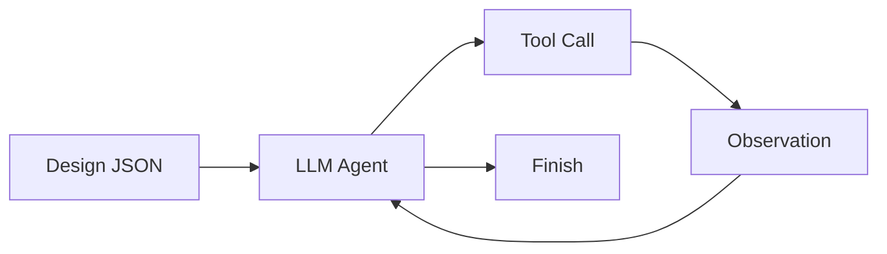

# Design-to-Code Agent

一个面向结构化工业设计的最小 Coding Agent：读取 `design.json` 中的状态机、约束和追溯 ID，生成 Python 类实现与 pytest 测试，并通过 ReAct 循环完成验证和修复。

项目刻意不使用 LangChain、LangGraph、CrewAI 等 Agent 框架，以显式展示 LLM 决策、工具执行和上下文回灌这三个底层机制。



## 当前示例：MotorController

`design_samples/design.json` 定义了一个带安全联锁的三状态电机控制器：

- 需求 ID：`REQ-MOTOR-001`
- 状态：`IDLE`、`RUNNING`、`FAULT`
- 转换：`start`、`stop`、`update_temperature`、`reset`
- 安全约束：
  - `FAULT` 下禁止 `start`
  - 温度大于 80 时立即锁存 `FAULT`
  - 只有 `FAULT` 且温度不高于 80 时才允许 `reset`
  - 非 `IDLE` 状态调用 `start` 抛出 `InvalidTransitionError`
  - 非 `RUNNING` 状态调用 `stop` 抛出 `InvalidTransitionError`
- 验收标准：`AC-001` 到 `AC-008`

设计文件还包含类名、方法签名、异常类型和验收标准，减少模型对接口的自由发挥。

## 已实现能力

- 读取结构化 JSON 设计，提取状态机、约束、接口和追溯 ID
- 生成基于 Python `Class` 的显式状态机
- 生成类型注解、自定义异常和安全检查
- 在代码中写入 `# [Trace: REQ-MOTOR-001/<ID>]` 追溯注释
- 自动生成 pytest 测试，覆盖初始状态、状态转换和异常路径
- 运行测试并读取完整失败输出
- 根据失败信息判断是业务实现错误还是测试预期错误，再修复并重跑
- 10 步硬上限，避免无限循环
- 路径沙箱：只能读取 `design_samples/`，只能写入 `workspace/`
- `--mock` 模式：无 API Key 也能查看完整执行轨迹
- 当前参考测试：**31 passed**

## 项目结构

```text
design-to-code-agent/
├── agent.py                    # ReAct 主循环、系统提示词、Mock 入口
├── tools.py                    # 4 个工具的实现与 JSON Schema
├── llm_client.py               # DeepSeek OpenAI 兼容客户端
├── design_samples/
│   └── design.json             # 工业级 MotorController 设计
├── workspace/
│   ├── motor_controller.py     # 已验证的生成结果（参考输出）
│   └── test_motor_controller.py
├── requirements.txt
├── .gitignore
└── README.md
```

`workspace/` 同时是 Agent 的唯一写入沙箱。仓库中保留了一份已经验证通过的参考输出，方便直接运行测试和查看效果；重新运行 Agent 时会覆盖这些文件。

## 快速运行

要求 Python 3.10+。项目只使用标准库和 `openai` SDK，测试使用 `pytest`。

```powershell
cd "C:\Users\VV\Desktop\code agent\design-to-code-agent"

python -m venv .venv
.\.venv\Scripts\python.exe -m pip install -r requirements.txt```

### Mock 模式（无需 API Key）

```powershell
.\.venv\Scripts\python.exe agent.py --mock
```

Mock 模式不会调用真实 API，也不会修改 `workspace/`，只打印预置轨迹。

### 真实模式

先从 [DeepSeek 平台](https://platform.deepseek.com/api_keys) 获取 API Key，然后在同一个终端中设置：

```powershell
$env:DEEPSEEK_API_KEY = "sk-你的真实Key"

.\.venv\Scripts\python.exe agent.py
```

代码使用：

```python
BASE_URL = "https://api.deepseek.com"
MODEL = "deepseek-chat"
```

API Key 只从环境变量读取，禁止写进源码或提交到仓库。

### 直接运行参考测试

```powershell
.\.venv\Scripts\python.exe -m pytest -q workspace
```

预期结果：

```text
31 passed
```

## Agent 循环

真实模式的循环位于 `agent.py` 的 `for step in range(MAX_STEPS)`：

1. 模型读取系统提示词和用户消息
2. 模型返回 `tool_calls`，例如 `read_design`
3. 主循环用 `json.loads` 解析工具参数
4. 执行工具，并将结果以 `{"role": "tool", "tool_call_id": ...}` 回灌
5. 模型继续决策
6. 没有新的工具调用时，打印最终答复并退出

测试失败时的反馈路径：

```text
run_tests
→ TESTS_FAILED + stdout/stderr
→ read_error
→ 模型判断：业务代码错误 / 测试预期错误
→ write_file 修复
→ run_tests
→ TESTS_PASSED
→ Finish
```

系统提示词明确要求：不得删除测试、放宽断言或削弱安全约束来“刷绿”。

## 工具契约

仍只保留 4 个工具，所有工具参数都使用完整 JSON Schema。

| 工具 | 输入 | 作用 |
|---|---|---|
| `read_design` | `path` | 读取 `design_samples/` 下的设计文件 |
| `write_file` | `path`, `content` | 在 `workspace/` 下写入或覆盖文件 |
| `run_tests` | 无 | 在 `workspace/` 执行 `python -m pytest -q`，30 秒超时 |
| `read_error` | 无 | 返回最近一次失败测试输出；最近一次通过时返回无失败信息 |

### 沙箱边界

- `read_design` 在 `resolve()` 后检查路径是否位于 `design_samples/`
- `write_file` 在 `resolve()` 后检查目标是否以 `workspace/` 绝对路径为前缀
- 拒绝 `..` 穿越、目录本身和未知工具
- 工具失败统一返回字符串，不把未捕获异常抛给主循环
- `run_tests` 超时或 pytest 不存在时也返回可回灌的错误字符串

注意：这是路径级沙箱，不是操作系统级安全隔离。`run_tests` 会执行工作区里的 Python 代码，生产环境应增加容器或进程隔离。

## 追溯示例

生成代码中的关键位置会显式绑定设计元素：

```python
class MotorController:
    # [Trace: REQ-MOTOR-001/ST-001] initial state is IDLE
    self._state = self.IDLE

    def start(self) -> None:
        if self._state == self.FAULT:
            # [Trace: REQ-MOTOR-001/CN-001]
            raise SafetyInterlockError(...)
        # [Trace: REQ-MOTOR-001/TR-001]
        self._state = self.RUNNING
```

测试文件同样使用追溯 ID：

```python
def test_start_in_fault_raises_safety_interlock_and_stays_fault():
    # [Trace: REQ-MOTOR-001/AC-005] [Trace: REQ-MOTOR-001/CN-001]
    m = MotorController(81)
    with pytest.raises(SafetyInterlockError):
        m.start()
    assert m.state == "FAULT"
```

## 运行 Trace 示例

下面是 Mock 模式的结构示意；真实运行时模型可能产生不同的 Thought，但工具和回灌顺序一致。

```text
[Step 1] Thought: 读取工业设计，提取状态机、约束和追溯 ID。
Action: read_design({"path": "design_samples/design.json"})
Observation: {"requirement_id": "REQ-MOTOR-001", "class": "MotorController", ...}

[Step 2] Thought: 用 Class 实现状态机，并将约束绑定到追溯注释。
Action: write_file({"path": "motor_controller.py", ...})
Observation: OK: wrote motor_controller.py

[Step 3] Thought: 生成覆盖状态、转换和约束的测试。
Action: write_file({"path": "test_motor_controller.py", ...})
Observation: OK: wrote test_motor_controller.py

[Step 4] Thought: 运行完整测试套件并确认安全约束。
Action: run_tests({})
Observation: TESTS_PASSED (exit 0)
31 passed in 0.04s

Finish: 已生成 MotorController 和测试，31 个测试通过。
```

## 为什么不用 Agent 框架

本项目的目标是显式暴露三个机制，而不是隐藏它们：

1. **ReAct 循环**：`agent.py` 中用单个 `for step in range(10)` 完成“请求模型 → 执行工具 → 回灌观察 → 再请求模型”。
2. **工具分发**：`tools.py` 用字典分发 4 个工具，JSON Schema 明确标注参数类型、描述和 required 字段。
3. **上下文管理**：assistant 的 `tool_calls`、每个工具结果都由主循环显式拼接，没有框架状态对象或隐藏的 agent executor。

## 设计取舍

### 做了

- 用结构化 JSON 设计约束模型，而不是让模型从自然语言自由发挥
- 用 Class 和显式状态常量实现状态机，便于测试和追溯
- 让 Agent 同时生成业务代码和测试，而不是只生成实现
- 将失败输出完整回灌，支持“定位—修复—重跑”闭环
- 保留最小工具集，减少框架抽象
- 用 Mock 模式提供无 Key 的可演示路径

### 没做

- 没有长期记忆、向量检索和多 Agent 协作
- 没有自然语言设计文档解析，只接受 JSON
- 没有 `list_files`、`delete_file`、`rename_file` 或 `apply_patch`
- 不能只运行指定测试文件，`run_tests` 始终运行整个 `workspace/`
- 没有静态检查、类型检查、覆盖率或依赖安装能力
- 没有独立的 JSON Schema 校验，设计文件的合法性主要靠提示词和模型判断
- 没有 API 重试、限流、token 预算和长上下文裁剪
- 没有操作系统级代码执行隔离
- 生成的测试仍由模型编写，测试质量没有被机械化保证

## 开发与验证

```powershell
# 语法检查
.\.venv\Scripts\python.exe -m py_compile agent.py tools.py llm_client.py

# Mock 轨迹
.\.venv\Scripts\python.exe agent.py --mock

# 完整测试
.\.venv\Scripts\python.exe -m pytest -q workspace
```

如果要从头演示生成过程，可以先删除参考输出，再运行真实模式：

```powershell
Remove-Item .\workspace\motor_controller.py, .\workspace\test_motor_controller.py -Force
.\.venv\Scripts\python.exe agent.py
```

## 与后续毕设的衔接

- `read_design` 是“设计理解”的入口。后续可以替换为更丰富的设计模型、接口契约、UML 或需求文档解析，同时保持 ReAct 主循环不变。
- `run_tests` + `read_error` + tool 消息回灌是“质量验证”的反馈钩子。后续可接入静态检查、类型检查、覆盖率或自定义验收器。
- 每次 `Action` 和 `Observation` 都是可追溯记录。后续可在此基础上构建“设计元素 → 生成代码 → 测试结果”的追溯图，并对失败修复路径进行可视化分析。
- 当前的 `requirement_id`、`TR-*`、`CN-*`、`AC-*` 已经为追溯图提供了稳定的节点标识。
