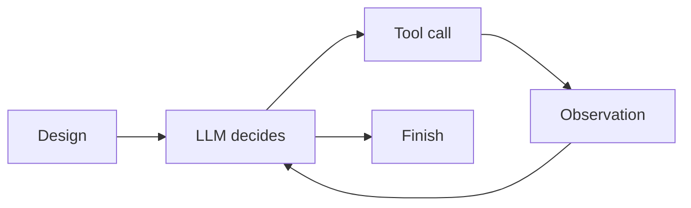

# design-to-code-agent

一个最小可运行的“设计 → 代码”Coding Agent：读取结构化设计，在 ReAct 循环中调用工具写代码、跑测试，并把失败信息回灌给模型继续修复。



## 快速运行

要求 Python 3.10+，仅使用标准库和 `openai` SDK。测试需要 `pytest`：

```bash
python -m pip install openai pytest
```

真实模式（默认）需要 API Key，使用 DeepSeek 的 OpenAI 兼容接口：

```bash
export DEEPSEEK_API_KEY="sk-..."      # macOS / Linux
# $env:DEEPSEEK_API_KEY="sk-..."      # PowerShell
python agent.py
```

Mock 模式不读取 API Key，也不需要安装 `openai`：

```bash
python agent.py --mock
```

`workspace/` 初始只有 `test_greeting.py`；真实 Agent 会读取 `design_samples/design.json`，生成 `workspace/greeting.py`，然后运行 `python -m pytest -q`。

## 为什么不用 Agent 框架

本项目的目标是显式暴露三个机制，而不是隐藏它们：

1. **ReAct 循环**：`agent.py` 中一个 `for step in range(10)` 直接完成“请求模型 → 执行工具 → 回灌观察 → 再请求模型”。
2. **工具分发**：`tools.py` 用字典分发 4 个工具，JSON Schema 手写生成，工具结果统一变成字符串，失败也不抛出未捕获异常。
3. **上下文管理**：assistant 的 `tool_calls`、每个 `{"role": "tool", "tool_call_id": ...}` 结果都由主循环显式拼接，没有框架状态对象。

没有 LangChain、LangGraph、CrewAI 或其他 Agent 框架。

## 设计取舍

**做了：**

- 4 个最小工具：`read_design`、`write_file`、`run_tests`、`read_error`。
- `write_file` 在 `resolve()` 后校验目标是否位于 `workspace/` 绝对路径之下，拒绝 `..` 穿越和目录本身；只允许读取 `design_samples/` 下的设计文件。
- 10 步硬上限，超限打印提示后退出，不会无限循环。
- 测试超时 30 秒，`stdout + stderr + exit code` 作为 observation 回灌。
- `--mock` 预置完整轨迹，无 Key、无网络、无 `openai` 包也能观察 Agent 形态。

**没做：**

- 没有长期记忆、向量检索、多 Agent 协作。
- 没有自然语言设计文档解析，只接受结构化 JSON。
- 没有细粒度 `edit_file`、代码审查、自动提交或回滚。
- 不防御恶意代码执行；`run_tests` 本质上会运行工作区中的 Python 代码，生产使用需要额外进程隔离。
- 没有 API 重试、限流、token 预算和长上下文裁剪。

## 运行 trace（Mock 模式）

下面是 `python agent.py --mock` 的预置轨迹，未调用真实 API，也未实际写入文件：

```text
[Mock] No API call; replaying a predefined successful run.

[Step 1] Thought: 先读取设计规格，确认模块名、函数签名和输出格式。
Action: read_design({"path": "design_samples/design.json"})
Observation: {"module": "greeting", "function": {"name": "greet", "description": "Return exactly 'Hello, <name>!' for the given name.", "input": [{"name": "name", "type": "string"}], "output": "string"}}

[Step 2] Thought: 设计要求 greeting.greet(name) 返回 Hello, <name>!，写入实现。
Action: write_file({"path": "greeting.py", "content": "def greet(name: str) -> str:\n    return f\"Hello, {name}!\"\n"})
Observation: OK: wrote greeting.py (58 chars)

[Step 3] Thought: 实现已写入，运行 pytest 验证行为。
Action: run_tests({})
Observation: ..                                                                       [100%]
2 passed in 0.01s
[exit code: 0]

Finish: 已根据设计实现 greet，2 个 pytest 测试全部通过。
```

真实模式采用同样的 `Thought → Action → Observation → Finish` 结构；测试失败时，`run_tests` 的失败输出会作为工具的 `tool` 消息回灌，模型随后可以再次调用 `read_error` 或 `write_file` 修复。

## 与后续毕设的衔接

- `read_design` 是“设计理解”的入口：当前只解析 JSON 规格，后续可替换为更丰富的设计模型、接口契约或 UML/需求文档解析，同时保持主循环不变。
- `run_tests` + `read_error` + tool 消息回灌是“质量验证”的反馈钩子：后续可接入静态检查、类型检查、覆盖率或自定义验收器，让反馈信号更完整。
- 每次 `Action` 与 `Observation` 天然构成一条可追溯记录；后续可在这一层引入追溯图（设计元素 → 生成文件 → 测试结果），并对失败修复路径做可视化分析。
